# LearnWhy AI — An Explainable, Misconception-Aware Personalized Learning Platform

> Verification note: run the backend/frontend test suites and evaluation script against this checkout before relying on reported results. Synthetic evaluation is not evidence of real-world learning gains.

| Field | Value |
| :--- | :--- |
| **Product Name** | **LearnWhy AI** |
| **Official Source Problem** | **PSM147** (Serial No. **47**) |
| **Official Problem Title** | **AI-Powered Personalized Learning Platform** |
| **PS Number & Theme** | **QE4** — *Quality Education* |
| **Full Proposed Title** | *LearnWhy AI — An Explainable, Misconception-Aware Personalized Learning Platform Using Knowledge Tracing and Adaptive Remediation* |
| **Initial Subject Domain** | Python Programming Education |

---

## 1. Overview & Differentiator

**LearnWhy AI** is a full-stack personalized learning platform for Python programming education that implements all six mandatory considerations from the official **PSM147 / QE4** problem statement alongside a transparent, testable learning loop:

$$\text{Attempt} \longrightarrow \text{Misconception Diagnosis} \longrightarrow \text{Diagnostic Follow-Up (when ambiguous)} \longrightarrow \text{Explainable Multimodal Intervention} \longrightarrow \text{Fresh Verification} \longrightarrow \text{Mastery Update}$$

### Six Mandatory Official Source-Sheet Considerations (`SRC-1` to `SRC-6`)
1. **Adaptive Learning Models (`SRC-1`)**: Maintains concept-level mastery estimates in $[0, 1]$ using a transparent baseline update ($M_{\text{new}} = (1 - \alpha) M_{\text{old}} + \alpha y$), respects directed prerequisite links, adapts question/activity difficulty, and explains every recommendation.
2. **Intelligent Tutoring Systems (`SRC-2`)**: Provides a progressive 3-step hint ladder, curated step-by-step explanations, plain-language summaries, worked examples, and deterministic answer validation that works 100% without an external LLM API key.
3. **Gamification & Engagement (`SRC-3`)**: Awards points for effort and milestones (`FIRST_ATTEMPT`, `ACTIVE_PRACTICE_5`, `VERIFIED_REMEDIATION_1`, `CONCEPT_BUILDER_2`), tracks daily goals and optional streaks, never locks learning content behind a paywall, and never penalizes learners for using hints or accessibility tools.
4. **Multimodal Learning (`SRC-4`)**: Offers readable text, annotated Python code blocks, accessible inline SVG flowcharts, optional Web Speech audio narration with synchronized text transcripts/captions, and interactive micro-checks as learner-selectable presentation formats (never fixed "learning-style" labels).
5. **Accessibility & Inclusivity (`SRC-5`)**: Keyboard-operable controls, skip-to-main-content link, visible focus rings, semantic HTML landmarks/tables, scalable typography (`normal` / `large` / `xlarge`), reduced-motion mode, high-contrast borders, non-color-only status badges, plain-language explanations, and English/Hindi bilingual support.
6. **Data-Driven Insights for Educators (`SRC-6`)**: Role-protected educator dashboard displaying class concept mastery and accuracy, common misconceptions with rule versions, learners flagged for supportive review with transparent alert rules, educator review notes/overrides, aggregate CSV export, and reproducible baseline evaluation metrics.

---

## 2. System Architecture & Diagrams

### High-Level Architecture

```mermaid
flowchart LR
  subgraph Client["React + TypeScript + Vite Frontend"]
    UI_Home["Home & Concept DAG"]
    UI_Learn["Learn Workspace (Question / Follow-Up / Remediation / Verification)"]
    UI_Prog["Progress & Accessible Charts/Tables"]
    UI_Edu["Educator Insights & CSV Export"]
    UI_Adm["Admin Content & Rule Studio"]
  end

  subgraph Server["Python + FastAPI Backend (/api)"]
    Auth["JWT Auth, RBAC & Rate Limiter"]
    Mastery["Mastery Engine: M_new = (1-α)M_old + αy"]
    Diag["Versioned Misconception & Follow-Up Engine"]
    Rec["Explainable Ranker (Proposed B vs Baseline A)"]
    Tutor["Curated Tutor + Optional LLM Adapter"]
  end

  subgraph DB["Relational Database (PostgreSQL / SQLite + SQLAlchemy + Alembic)"]
    Tables["17 Normalized Entities + Audit & Research Logs"]
  end

  Client <-->|"JSON / CSV over /api"| Server
  Server <--> Tables
```


### Normalized Relational Database Schema (17 Entities)
- `users`: Accounts (`student`, `educator`, `admin`), bcrypt password hashes, points, streak preferences.
- `learner_preferences`: Language (`en`, `hi`, `bilingual`), `text_size`, `reduced_motion`, `high_contrast`, `plain_language_mode`, `preferred_formats`.
- `courses`: Versioned course catalog (`python-foundations-101`).
- `concepts`: 6 core Python concepts (`variables-expressions`, `conditions`, `loops`, `functions`, `lists`, `list-iteration`).
- `concept_prerequisites`: Directed edges (`concept_id`, `prerequisite_id`) with self-loop check constraints.
- `misconceptions`: Versioned diagnostic rules (`MISC-VAR-REASSIGN`, `MISC-COND-ELIF-CHAIN`, `MISC-LOOP-RANGE-STOP`, etc.).
- `questions`: Curated questions with `stable_id`, `answer_key`, `explanation`, `plain_language_explanation`, `worked_example`, `hint_ladder`, `diagram_svg`, `audio_transcript`, and flags `is_diagnostic_followup` / `is_verification_only`.
- `answer_options`: Options mapped to primary and optional secondary misconceptions (`confidence_weight`, `ambiguity_note`).
- `activities`: Multimodal remediation modules with text, code, SVG diagrams, audio transcripts, and interactive checks.
- `attempts`: Raw learner responses (`practice`, `diagnostic_followup`, `verification`) separated from diagnoses.
- `diagnoses`: Candidate misconceptions, confidence, evidence, `status` (`diagnosed`, `ambiguous_followup_needed`, `insufficient_evidence`, `resolved_by_followup`, `correct_no_error`), and `rule_version`.
- `mastery_states`: Concept mastery estimates in $[0, 1]$, attempt counts, uncertainty bounds, and `model_version`.
- `recommendations`: Stored rank, plain-language `reason`, and `score_components` JSON.
- `intervention_outcomes`: Pre/post mastery, immediate verification outcome, `error_recurred`, and educator review notes.
- `achievements` & `user_achievements`: Non-punitive gamification badges and earned timestamps.
- `audit_events`: Sanitized research and content audit logs (never logging passwords, tokens, or secrets).

---

## 3. Core Algorithms

### 3.1 Baseline Concept Mastery Update
$$M_{\text{new}} = (1 - \alpha) \cdot M_{\text{old}} + \alpha \cdot y$$
where $M_{\text{old}} \in [0, 1]$, $y \in \{0, 1\}$, and $\alpha = 0.20$ (configurable via `MASTERY_ALPHA`). Updates **only** the concept measured by the attempted question. Framed explicitly as a heuristic estimate of recent performance, not a fixed measure of student ability.

### 3.2 Transparent Misconception Diagnosis & Ambiguity Disambiguation
- **Single High-Confidence Rule ($\ge 0.70$)**: Status `diagnosed`, stores candidate misconception, confidence, evidence, and `rule_version`.
- **Ambiguous Evidence (Multiple Competing Causes)**: Status `ambiguous_followup_needed`, lists competing candidate misconceptions, and presents a short **diagnostic follow-up question** (`POST /api/attempts/{id}/diagnostic-follow-up`) to disambiguate before recommending remediation.
- **Unmapped Wrong Answer**: Status `insufficient_evidence`, avoiding overconfident false diagnoses from a single response.

### 3.3 Explainable Recommendation Ranking
$$R(\text{activity}) = 0.50 \cdot \text{gap\_relevance} + 0.30 \cdot \text{prerequisite\_importance} + 0.20 \cdot \text{difficulty\_fit}$$
Each component is normalized to $[0, 1]$ with configurable weights (`REC_WEIGHT_GAP`, `REC_WEIGHT_PREREQ`, `REC_WEIGHT_DIFFICULTY`). Every recommendation stores its component values and a plain-language reason.

---

## 4. Local Setup & Run Instructions

### 4.1 Environment Variables
Copy `.env.example` to `.env` (optional for local non-Docker run; safe defaults are preconfigured):
```bash
cp .env.example .env
```
| Variable | Default | Purpose |
| :--- | :--- | :--- |
| `DATABASE_URL` | `sqlite:///./backend/learnwhy.db` | SQLite default or `postgresql+psycopg2://...` for PostgreSQL |
| `JWT_SECRET_KEY` | Placeholder dev secret | HMAC-SHA256 signing key for session tokens |
| `MASTERY_ALPHA` | `0.20` | Configurable EMA learning rate $\alpha$ |
| `REC_WEIGHT_GAP` | `0.50` | Provisional weight for gap relevance |
| `REC_WEIGHT_PREREQ` | `0.30` | Provisional weight for prerequisite importance |
| `REC_WEIGHT_DIFFICULTY` | `0.20` | Provisional weight for difficulty & preference fit |
| `LLM_PROVIDER` | `none` | Optional server-side LLM adapter (`none` uses deterministic curated tutor) |

### 4.2 Option A: Non-Docker Local Setup (Recommended for Quick Evaluation)
```bash
# 1. Install backend dependencies, run Alembic migrations, and seed sample data
cd backend
pip install -r requirements.txt
alembic upgrade head
python3 -m app.seed

# 2. Start the FastAPI backend on port 8000
uvicorn app.main:app --host 0.0.0.0 --port 8000

# 3. In a second terminal, install and start the React + Vite frontend on port 5173
cd ../frontend
npm install
npm run dev
```

### 4.3 Option B: Docker Compose (PostgreSQL 16 + FastAPI + Vite)
```bash
docker compose up --build
```

### 4.4 Demo Accounts (Pre-Seeded Sample Data)
| Role | Email | Password | Highlights |
| :--- | :--- | :--- | :--- |
| **Student** | `aarav.student@demo.learnwhy.edu` | `StudentPass123!` | Active learner with concept progress, badges & recommendations |
| **Student (Needs Review)** | `priya.student@demo.learnwhy.edu` | `StudentPass123!` | Learner flagged for supportive educator review on Loops |
| **Educator** | `meera.educator@demo.learnwhy.edu` | `EducatorPass123!` | Class analytics, common misconceptions, CSV export & baseline eval |
| **Admin** | `vikram.admin@demo.learnwhy.edu` | `AdminPass123!` | Manage questions, misconception rules, concepts & audit logs |

---

## 5. Automated Testing & Reproducible Evaluation

### Run Backend Unit & Integration Tests (`pytest`)
```bash
cd backend
pytest -v
```

### Run Frontend Component & Accessibility Tests (`vitest`)
```bash
cd frontend
npm run test
```

### Run Reproducible Baseline A vs. Proposed B Evaluation
```bash
python3 evaluation/evaluate_methods.py
```
This script evaluates `evaluation/labeled_evaluation_dataset.json` ($N_{\text{dev}}=4$, $N_{\text{test}}=12$ held-out test cases) and writes `evaluation/latest_evaluation_report.json`.
*Note: All benchmark figures are explicitly labeled as synthetic / expert-labeled technical evaluation data, not clinical human-subjects findings.*
